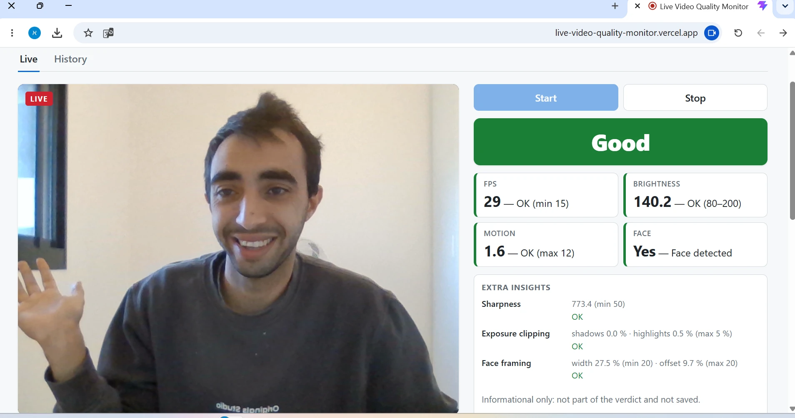
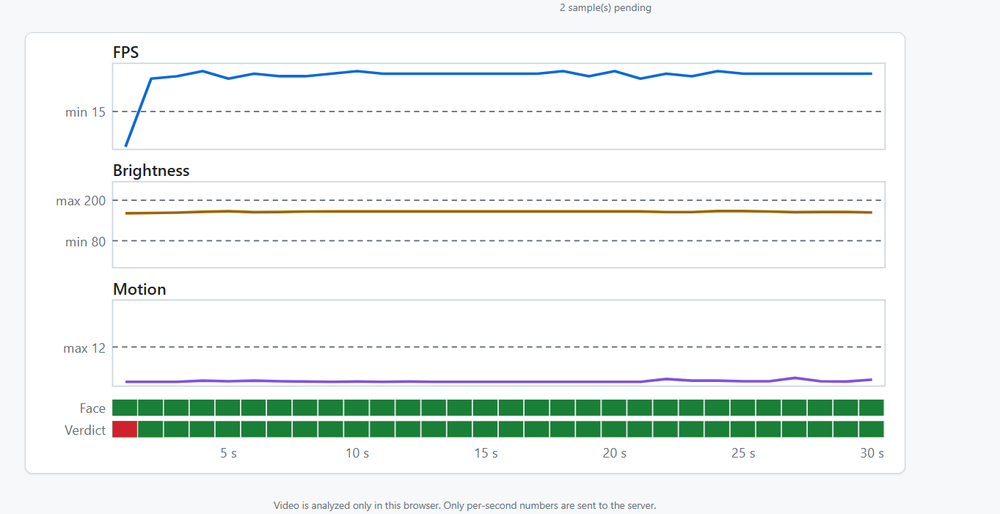

# Live Video Quality Monitor

Opens your webcam, analyzes every frame **in the browser**, and shows live quality metrics (FPS,
brightness, motion, face present), a per-second **Good / Poor** verdict with its reason, and a 30 s
live chart. Each session's per-second samples are stored by a Python backend in Postgres; the
History screen replays any session. **Video never leaves the browser**: only numbers are sent.

| | |
|---|---|
| **Live app** | https://live-video-quality-monitor.vercel.app (Chrome on a laptop) |
| **API** | https://vqm-backend.onrender.com (`/health`, `/docs`) |
| **Repository** | https://github.com/eyalshub/live-video-quality-monitor |

> **Cold start:** the free Render backend sleeps after ~15 min idle. The first request can take
> **up to ~1 minute**; the page says the backend may be waking up and waits (120 s timeout; a wake-up of 66 s was measured).
> Open the app (or `/health`) once before a demo.





**Reading the two strips under the chart** (one cell per second): **Face** is the detector's answer
(green = a face was present that second, after the stability filter). **Verdict** is the final
Good / Poor for that second and combines all four rules below, so it can be red while Face is
green. In the screenshot the first second is red because FPS was still below 15 while the camera
started.

## Run locally

Prerequisites: Docker Desktop, [uv](https://docs.astral.sh/uv/), Node 24.

```bash
docker compose up -d                       # Postgres 16 (+ a separate test database)

cd backend
cp .env.example .env
uv sync
uv run python -m alembic upgrade head
uv run python -m uvicorn app.main:create_app --factory --reload --port 8000

cd ../frontend                             # second terminal
cp .env.example .env
npm install
npm run dev                                # http://localhost:5173 (camera works on localhost)
```

Checks: `cd backend && uv run ruff check . && uv run mypy && uv run python -m pytest -q` and
`cd frontend && npm run lint && npm run typecheck && npm test && npm run build`. The same run in
GitHub Actions on every push.

## Stack and free services

| Part | Technology | Hosting (free tier) |
|---|---|---|
| Frontend | React 19 + Vite + TypeScript (strict), own SVG chart | **Vercel** |
| Face detection | MediaPipe Tasks Vision, BlazeFace short range: detection only, in the browser; model and wasm served by the app (no CDN) | in the browser |
| Backend | Python 3.12, FastAPI, SQLAlchemy 2, Alembic, Pydantic v2 | **Render** web service |
| Database | Postgres 16 | **Neon** (Frankfurt) |

**No credit card anywhere.** Why these: Vercel serves a static build over HTTPS (the camera needs
HTTPS). Render runs a Python web service for free. **Neon, not Render Postgres** (Render's free
database expires after a limited time) **and not Supabase** (free projects pause after a few days
without use). The app must stay up until the demo. Locally, Postgres runs in Docker for parity
with Neon. Details: [`docs/deploy.md`](docs/deploy.md), decisions in [`docs/decisions/`](docs/decisions/).

## Thresholds

Owned by the backend (env vars), returned to the browser when a session starts, and **snapshotted
on each session** so History stays correct if they change ([ADR-002](docs/decisions/ADR-002-thresholds-owned-by-backend.md)).

| Metric | How it is measured | Poor when | Reason shown |
|---|---|---|---|
| Face | at least one face detected in any frame of the second; a face must hold still for 5 detector runs ([ADR-017](docs/decisions/ADR-017-face-must-hold-still.md)) | no face | No face |
| Brightness | mean luma `0.299R + 0.587G + 0.114B`, 0–255 | **< 80** / > 200 | Too dark / Too bright |
| Motion | mean abs. luma difference vs. the previous frame, 0–255 | **> 12** | Hold still |
| FPS | frames our code actually processed in that second | < 15 | Low FPS |

**Calibrated on a real laptop webcam** ([ADR-012](docs/decisions/ADR-012-thresholds-calibrated-on-a-real-webcam.md)):
a normal room measures 120–135, but camera auto-gain keeps even a dark room near 79, so the
suggested 60 never fired, hence 80. Sitting gives motion 3–6 and moving the head ~16, so the
suggested 20 never fired, hence 12. In the dark the camera itself drops to ~9 FPS, so `low_fps` is
real and reported honestly.

When several rules fail, the first in this order is the reason: no face → too dark / too bright →
hold still → low FPS. Each metric card still shows its own status, so covering the camera shows
"Too dark" even when the verdict says "Poor: no face". Values are rounded to 1 decimal before
judging, and the server re-checks every verdict against the session's thresholds
([ADR-003](docs/decisions/ADR-003-verdict-on-rounded-values.md)). The browser and the server
share one table of test cases ([`shared/verdict-cases.json`](shared/verdict-cases.json)).

## Measurement and calibration

The thresholds and the face filter were chosen from **measured, labelled recordings**, not by eye.
Two read-only tools do the analysis: `backend/tools/calibrate.py` (verdict thresholds,
[ADR-014](docs/decisions/ADR-014-threshold-calibration-protocol.md)) and `npm run face:eval` (face
detector, [ADR-015](docs/decisions/ADR-015-face-false-positives-measured.md)). Recordings are
numbers only: per-second samples in the database, and with `?debug` a per-frame log of face scores
and keypoints that the user downloads. Video never leaves the browser.

### The measures we used
- **Miss rate:** of the seconds that *should* be flagged (a real face, a dark room, a moving head),
  the share that was not. **False-alarm rate:** of the seconds that should *not* be flagged, the
  share that was. Every threshold trades one against the other, so both are always reported.
- **Seconds, not frames:** the user sees one verdict per second, so errors are counted per second.
  This matters: under the task's rule (a face in *any* frame of the second), a 2 % per-frame error
  becomes about 45 % wrong seconds (`1 − 0.98^30`).
- **ROC AUC** (face detector): the probability that a frame with a face scores higher than a frame
  without one. 1.0 = perfect separation, 0.5 = a coin flip.
- **Balanced error** `(miss + false alarm) / 2`: how the calibration tool proposes a threshold.
- **IoU** (intersection over union) of two boxes: how "the same place" is decided across frames.
- **Tuning vs. validation:** settings were chosen on one set of recordings and then checked on new
  ones, so the reported result is not just a fit to the data it was tuned on.

### Verdict thresholds (11 labelled sessions)
| Threshold | What the data showed | Decision |
|---|---|---|
| Brightness min **80** | Dark ≤ 56, normal ≥ 131: zero misses, zero false alarms | Kept, now backed by data |
| Brightness max **200** | A lamp aimed at the lens reached 176: the camera's auto-exposure compensates | Kept (task value); this webcam cannot reach it |
| Motion max **12** | A moving head peaked at 8.7, so 12 missed it; ~3 would catch 89 % with 2 % false alarms | Unchanged for now: one session is too little evidence (see below) |
| FPS min **15** | 3.8 % false alarms in normal light | Kept (task value) |

### Face detector: a waving hand counted as a face
**Round 1 (tuning, 12 logs).** The model separates faces from hands well per frame (ROC AUC
0.989), but the any-frame rule turned rare frame errors into a hand being a "face" in 33 % of its
seconds and an object in 28 %. Tested on the same frames: a keypoint-geometry check (29 %) and a
box-size check (33 %) did not help, because BlazeFace places face-like keypoints on a hand too.
Raising the score threshold to 0.65 helped but lost 46 % of far-face seconds. Requiring the face to
**hold still for 5 detector runs** gave 3 % / 10 % with 1.5 % missed faces.

**Round 2 (validation, 6 new logs, filter on).** The same new frames, replayed both ways:

| Scenario | Without the filter | With the filter |
|---|---|---|
| Hand (false faces) | 64.6 % | **16.9 %** |
| Object (false faces) | 55.9 % | **20.6 %** |
| Face, normal light (missed) | 0.0 % | 0.0 % |
| Face, dark (missed) | 3.1 % | 3.1 % |
| Face, 1.5–2 m away (missed) | 5.3 % | **28.9 %** |

The live app's own numbers matched the replay exactly. About **70 % fewer false faces**, and no
change for a face at laptop distance or in the dark. Validation was harder than tuning (the hand was
moved to fool the detector on purpose), which is why 18 % false faces remain, not the 4 % round 1
predicted. A hand or object held still looks like a face to the model; rejecting it would need a
second model.

**Distance.** The detector (BlazeFace short range) is built for a person sitting close to the
screen, within about 2 m. Its scores fall with distance, so the further away the face, the larger
the error: 29 % missed seconds at 1.5–2 m, more beyond. This app targets a person at a laptop.

**Limits.** One webcam, one person, one room, one day; seconds within a recording are correlated,
so the rates are descriptive, not statistical guarantees. A photo of a face *is* a face to a
detector (no liveness, by the task's rules).

## Beyond the spec: extra insights

Three image-quality hints in an "Extra insights" panel on the live screen. They are
**informational only**: they never affect the verdict, the samples, the API or the database. They
are computed in the browser, not stored, not in History, and their limits are frontend env vars
([ADR-013](docs/decisions/ADR-013-extra-insights-client-only.md)). Image quality only: no emotion,
age, identity or attention.

- **Sharpness:** variance of the Laplacian on the downscaled frame → "Blurry".
- **Exposure clipping:** % of crushed (luma ≤ 5) and blown (≥ 250) pixels → catches a bright window
  behind a dark face that the average brightness hides.
- **Face framing:** from the detector's box → "Move closer", "Center your face", "Face cut off".

## Architecture

```
Browser (Chrome, HTTPS)
  camera 640x480 → frame loop (requestVideoFrameCallback) → 160x120 canvas
  → luma, motion, face (MediaPipe) per frame → 1 sample per second → verdict
  → live UI + 30 s chart          → outbox (batch every 1.5 s, kept on failure)
                                        │ JSON, numbers only
                                        ▼
FastAPI on Render: CORS (one origin) → validation → verdict re-check
  → INSERT … ON CONFLICT (session_id, t) DO NOTHING; summary computed in SQL at read time
                                        ▼
Postgres on Neon: sessions (threshold snapshot), samples (PK session_id + t)
```

Endpoints: `POST /sessions`, `POST /sessions/{id}/samples`, `POST /sessions/{id}/stop`,
`GET /sessions`, `GET /sessions/{id}`. See [`docs/api-contract.md`](docs/api-contract.md).
Every error uses one body: `{"error": {"code", "message", "details"}}`.

## Edge-case choices

| Case | Behavior |
|---|---|
| **Stop twice** | 200 with the same `ended_at`. Stop carries the browser's remaining samples and ends the session in one transaction ([ADR-004](docs/decisions/ADR-004-stop-carries-final-samples.md)). |
| **Samples after Stop** | Always **200, never written**: already stored → `duplicates`, new → `ignored_after_stop`. No error for a timing race, and an ended session never changes ([ADR-010](docs/decisions/ADR-010-samples-after-stop-200.md)). |
| **Network drop** | Unsent samples stay in an outbox ("N samples pending") and are resent with the next batch. `(session_id, t)` is the primary key, so a resent sample is a duplicate, never a second row. |
| **Tab closed without Stop** | On `pagehide` the outbox is sent with `fetch(…, {keepalive: true})`. The session stays open and its duration runs to its last sample (History: "In progress / ended without Stop"). |
| **Camera denied / missing / busy** | A clear message and Start again. The camera opens **before** the session is created, so a denial never leaves an empty session ([ADR-006](docs/decisions/ADR-006-camera-first-then-session.md)). |
| **Session duration** | `max(t) + 1`, not `t` of the last sample as the task words it: `t` starts at 0, so samples `t = 0…59` are 60 s. Seconds lost to a hidden tab still count as elapsed time; averages use stored samples only ([ADR-016](docs/decisions/ADR-016-duration-is-max-t-plus-one.md)). |
| **Leaving during Start** | If the user leaves the live screen while the session is still being created, it is ended at once with no samples, so no session is left open. |
| **Honest numbers** | A second with no frames produces no sample (a gap, not 0). Motion that cannot be measured is `null` ([ADR-009](docs/decisions/ADR-009-nullable-motion.md)). The partial last second at Stop is not sent. |

All cases: [`docs/edge-cases.md`](docs/edge-cases.md).

## Known debt / not finished

- No automated browser (camera) test in CI. A headless-Chrome run with a fake camera was done
  locally; unit and component tests run in CI (backend 174, frontend 213).
- No concurrent race test for Stop vs. an in-flight samples request. A row lock serializes them.
- Extra-insight limits are first guesses, not yet calibrated on a real camera. The panel shows the
  raw values for that.
- One laptop, one person calibrated the thresholds and the face filter (see Measurement and
  calibration). Motion max 12 is likely too high; one moving-head session is not enough to change it.
- Faces further than about 2 m are missed more often (BlazeFace short range, ADR-017).
- No authentication, by design of the task: everyone sees the same History.

---
Working notes for contributors and agents: [`AGENTS.md`](AGENTS.md) and [`docs/progress.md`](docs/progress.md).
